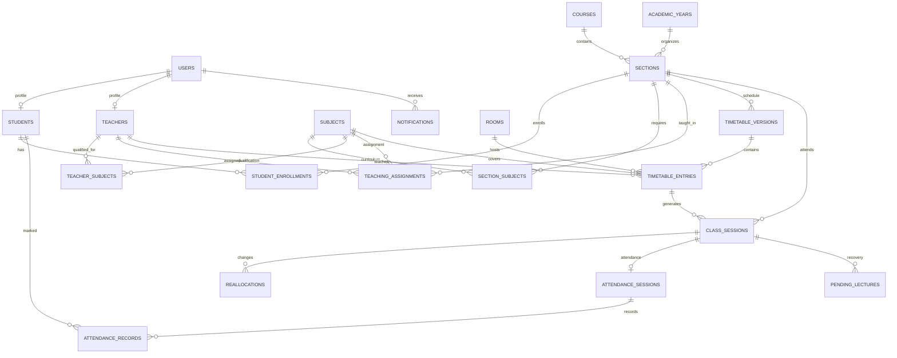

# Student System Database Design and Schema

This is the PostgreSQL 18 schema contract and implementation reference, targeting Render managed PostgreSQL. Keep the API and database in the same region (Singapore is recommended for India, subject to deployment configuration). Enable `btree_gist` by migration for overlap exclusion constraints. Recurring timetable times use institution timezone `Asia/Kolkata`. It models the PRD's MVP and keeps the current Flask demo data separate from durable application data. SQLAlchemy metadata and Alembic migrations `0001_initial_schema` through `0004_subject_course` implement the current structure. No Render database has been provisioned.

## Design principles

- Store each fact once where possible and connect records with foreign keys.
- Keep identity/login separate from student and teacher profiles.
- Keep the published repeating timetable separate from each dated class occurrence.
- Preserve the originally scheduled assignment, the current assignment, pending lecture recovery, and every proposed/applied change.
- Make attendance refer to the actual dated class session.
- Store passwords only as secure password hashes. Do not import the demo passwords as real credentials.
- Treat the dated `class_sessions` rows as the authoritative calendar of actual class slots. Every accepted published class becomes a session row, and PostgreSQL rejects resource overlaps there.
- Use foreign keys, composite foreign keys, unique keys, check constraints, and exclusion constraints as the default integrity layer; use transactional validation only for rules that cannot be expressed declaratively.

## Relationship map



## Tables

### Identity and academic structure

| Table | Important fields | Purpose and key rules |
|---|---|---|
| `users` | `user_id` PK, `login_id` UNIQUE (case-insensitive normalized ERP ID or faculty code), nullable `email` UNIQUE when present, `password_hash`, `is_active`, timestamps | Login identity. Authenticate with the institution-issued student ERP ID or faculty code; email is optional contact/recovery data, not the login key. A unique functional index on `lower(login_id)` prevents case variants. Never store plaintext passwords. |
| `user_roles` | `user_id` FK, `role` (`STUDENT`, `TEACHER`, `ADMIN`) | PK (`user_id`, `role`); allows an authorized person to hold more than one role. |
| `login_attempts` | normalized `login_id` PK, failure count, attempt-window start, optional lock expiry | Persistent per-login throttling state; after five failures in 15 minutes, the login is temporarily locked for 15 minutes. It contains no passwords or request payloads. |
| `students` | `student_id` PK, `user_id` FK UNIQUE, `erp_id` UNIQUE, name | Student-specific profile. |
| `teachers` | `teacher_id` PK, `user_id` FK UNIQUE, `faculty_code` UNIQUE, name, department | Teacher-specific profile. |
| `academic_years` | `academic_year_id` PK, name, `starts_on`, `ends_on`, status | Date boundaries must be valid; at most one active year. |
| `courses` | `course_id` PK, code UNIQUE, name | e.g. BCA. |
| `sections` | `section_id` PK, `course_id` FK, `academic_year_id` FK, semester, section_code, shift, capacity | UNIQUE (`course_id`, `academic_year_id`, `semester`, `section_code`); shift is a validated enum or lookup. Also UNIQUE (`section_id`, `course_id`) for composite references. |
| `student_enrollments` | `enrollment_id` PK, `student_id` FK, `section_id` FK, `starts_on`, `ends_on`, status | History of section membership. A student can have only one active enrollment at a time; enforce with a date-range exclusion constraint. Add UNIQUE (`enrollment_id`, `student_id`, `section_id`) for attendance references. |
| `subjects` | `subject_id` PK, nullable `course_id` FK, nullable semester/curriculum version/type, code UNIQUE, name, `requires_lab` | Course-linked subject catalog. Legacy unmapped rows remain nullable for review; new UI-created subjects require a course. Course and semester must match the section curriculum. |
| `section_subjects` | `section_id` FK, `subject_id` FK, `required_lecture_hours`, `required_lab_hours` | PK (`section_id`, `subject_id`); defines curriculum and required hours for a particular section. Counts of completed hours should be derived from completed sessions. |

### Teacher qualifications and assigned teaching

| Table | Important fields | Purpose and key rules |
|---|---|---|
| `teacher_subjects` | `teacher_id` FK, `subject_id` FK | PK (`teacher_id`, `subject_id`); records the subjects the teacher is qualified to teach. |
| `teaching_assignments` | `assignment_id` PK, `teacher_id` FK, `subject_id` FK, `section_id` FK, effective dates, status | Restricts teaching to valid teacher/subject/section combinations. Composite FKs require (`teacher_id`, `subject_id`) in `teacher_subjects` and (`section_id`, `subject_id`) in `section_subjects`. Add UNIQUE (`assignment_id`, `section_id`, `subject_id`, `teacher_id`) so schedule/session rows can reference the exact valid assignment. Assignment periods for a teacher/subject/section must not overlap. |

Separating qualification from assignment allows the system to distinguish “is allowed to teach this subject” from “is assigned to this section this term.” Reallocation must satisfy both and must also be in the section curriculum.

### Rooms and availability

| Table | Important fields | Purpose and key rules |
|---|---|---|
| `rooms` | `room_id` PK, building, room_number, capacity, `room_type`, status | UNIQUE (`building`, `room_number`); type is a controlled value such as `NORMAL`, `COMPUTER_LAB`, `SCIENCE_LAB`. |
| `room_features` | `room_id` FK, feature_code | PK (`room_id`, `feature_code`); optional extensible room capabilities. |
| `scheduling_policies` | `policy_id` PK, scope (institution or section), reallocation mode, max cascade depth, scoring weights, updated_by, updated_at | Admin-managed rules; suggest-and-approve is the initial mode, with auto-apply available as an explicit setting per PRD FR-6.4. Constrain cascade depth to 1 or 2. Store weights as typed columns or normalized policy-weight rows so the API can validate known settings. |
| `teacher_availability` | `availability_id` PK, `teacher_id` FK, `starts_at`, `ends_at`, availability status, reason, created_by | Dated unavailability or availability window. Require `starts_at < ends_at`. |
| `room_availability` | `room_availability_id` PK, `room_id` FK, `starts_at`, `ends_at`, status, reason, created_by | Dated room closure/availability window; require valid time bounds. |
| `academic_events` | `event_id` PK, `section_id` nullable FK, event type, `starts_at`, `ends_at`, title | Calendar blocks such as exams and holidays. A null section can represent a campus-wide event. |

### Planned timetable and dated sessions

| Table | Important fields | Purpose and key rules |
|---|---|---|
| `timetable_versions` | `timetable_version_id` PK, `section_id` FK, name, status (`DRAFT`, `PUBLISHED`, `ARCHIVED`), `effective_from`, `effective_to`, `published_by` | Keeps schedule edits and history. Require valid inclusive date bounds. Only one published version per section may cover a given date; overlapping active effective periods are rejected. Do not overwrite a published schedule in place. Add UNIQUE (`timetable_version_id`, `section_id`) for composite references. |
| `timetable_entries` | `entry_id` PK, `timetable_version_id`, `section_id`, `teaching_assignment_id`, `room_id` FK, `weekday`, `starts_at_local`, `ends_at_local` | One repeating weekly slot. Composite FKs require the section to equal the version's section and the assignment's section. Subject and teacher come from the assigned teaching relationship, not independently typed identifiers. Require start < end; never create an entry for a break. |
| `class_sessions` | `class_session_id` PK, nullable `entry_id` FK, `section_id` FK, `session_date`, `original_assignment_id`, `current_assignment_id`, `original_subject_id`, `current_subject_id`, `original_teacher_id`, `current_teacher_id`, `original_room_id`, `current_room_id`, original/current start/end instants, status, change reason | One dated occurrence/slot. Composite FKs prove original/current teacher, subject, and section match their assignment IDs. Original values are immutable; current fields define what happens. Require current start < end; unique (`entry_id`, `session_date`) for generated sessions. A recovery occurrence has no repeating entry and references its pending lecture. |
| `pending_lectures` | `pending_lecture_id` PK, originating `class_session_id` FK UNIQUE, `section_id` FK, `subject_id` FK, preferred `teaching_assignment_id` nullable FK, state, created_at, due_by | Tracks the missed curriculum obligation. One recovery obligation per originating session; one accepted recovery session per pending lecture. Keep section/subject consistent with the originating session through composite FKs or a constraint trigger. |
| `reallocations` | `reallocation_id` PK, `cascade_group_id` UUID, `cascade_depth` (0–2), optional self-FK `parent_reallocation_id`, `class_session_id` FK, optional `pending_lecture_id` FK, status (`PROPOSED`, `ACCEPTED`, `REJECTED`, `REVERTED`), reason, initiator nullable FK, proposed assignment/room/time, previous assignment/room/time, created_at, decided_by, decided_at | Each member stores one actual session change; rows with the same group UUID form one multi-session plan. The root has depth 0; blocker moves are linked to their direct parent. Group decisions/reverts are atomic. Suggest-and-approve is default; auto-apply obeys the policy depth (1 by default, maximum 2), and deeper plans wait for admin action. |

The session's original and current assignment are intentionally both represented. The repeating timetable describes the planned pattern; a dated session describes what is planned or actually happening on a particular date. If an existing lecture is moved into a disrupted slot, its source occurrence must be reassessed and must not be duplicated as completed teaching.

When a timetable version is published, generate section-based dated sessions across its full effective period, excluding holidays and exam periods. The MVP does not model lab subgroups or shared lectures across sections.

### Attendance and notifications

| Table | Important fields | Purpose and key rules |
|---|---|---|
| `attendance_sessions` | `attendance_session_id` PK, `class_session_id` FK UNIQUE, `section_id`, status, opened_by, opened_at, closed_at | Attendance collection for one actual class session. Composite FK binds (`class_session_id`, `section_id`) to the class session's section. |
| `attendance_records` | `attendance_record_id` PK, `attendance_session_id`, `student_id`, `section_id`, `enrollment_id`, status (`PRESENT`, `ABSENT`, `LATE`, `EXCUSED`), marked_by, marked_at | UNIQUE (`attendance_session_id`, `student_id`). Composite FKs prove the student has an enrollment in the exact section for which attendance is being recorded. |
| `notifications` | `notification_id` PK, `user_id` FK, event type, title, message, optional related session/reallocation FK, created_at, read_at | Persisted per-recipient message and read state. Do not use a shared mutable notification row for multiple recipients. |
| `announcements` | `announcement_id` PK, `created_by` FK, title, body, audience scope, optional section FK, published_at, expires_at | Admin-authored announcements with explicit audience and publish/expiry times; recipients are resolved from valid roles/enrollments rather than a global mutable notification. |
| `audit_events` | `audit_event_id` PK, actor nullable FK, entity type/id, action, timestamp, structured details | Append-only record for important admin and system mutations outside reallocation history. Keep credentials and sensitive secrets out of details. |

## Integrity rules that matter most

1. **No duplicate or overlapping classes.** Enforce three PostgreSQL GiST exclusion constraints on dated `class_sessions`: no overlap by `section_id`, `current_teacher_id`, or `current_room_id`. Use `[start,end)` ranges, which allow one class to start exactly when another ends. Ignore only explicitly cancelled/void sessions. Composite foreign keys prove the teacher and subject projections match the selected teaching assignment. This makes all three constraints direct, indexable, and concurrency-safe.
2. **No unqualified teaching or mismatched relationships.** Composite foreign keys bind each timetable entry to its version's section, curriculum subject, and teaching assignment. A teaching assignment must match a teacher qualification and section curriculum row. Constraint triggers or locked transactions additionally verify effective dates and active statuses; ordinary `CHECK` constraints cannot verify another table's rows.
3. **No capacity or room-type mismatch.** Check section capacity and lab requirements before accepting a room. Use a trigger or transactional validation because the rule spans rows.
4. **No unavailable-resource assignment.** Check teacher/room availability and academic exam blocks in the same transaction that accepts a schedule change. Lock the relevant session/resource rows to avoid concurrent changes slipping through.
5. **Atomic changes.** Update every moved session in a cascade group, pending lecture state, reallocation status, recipient notifications, audit history, and outbox in one database transaction. Notify after commit from an outbox/worker so a failed notification cannot leave half-applied scheduling data.
6. **Attendance follows the actual session.** Attendance references `class_sessions`, not only recurring timetable entries. Unique keys prevent duplicate marks for the same student and class.
7. **History stays queryable.** Published timetable versions and accepted/rejected/reverted reallocations are retained. Corrections create a new event or version instead of erasing the prior decision.

### Database-enforced overlap pattern

Every class session stores the canonical `section_id`, `current_teacher_id`, `current_subject_id`, `current_room_id`, and timezone-aware `current_starts_at` / `current_ends_at`. Composite foreign keys bind (`current_assignment_id`, `section_id`, `current_subject_id`, `current_teacher_id`) to the corresponding unique teaching-assignment key. This controlled duplication lets PostgreSQL index each resource directly without allowing contradictory teacher/subject/section values. Apply equivalent composite references to the immutable original assignment snapshot. The three exclusion constraints below are normative migration behavior (enum names/columns may be adapted, but not the guarantees):

```sql
CREATE EXTENSION IF NOT EXISTS btree_gist;

-- A section cannot have two simultaneously published timetable versions.
ALTER TABLE timetable_versions
  ADD CONSTRAINT no_published_version_period_overlap
  EXCLUDE USING gist (
    section_id WITH =,
    daterange(effective_from, effective_to, '[]') WITH &&
  ) WHERE (status = 'PUBLISHED');

ALTER TABLE class_sessions
  ADD CONSTRAINT class_session_valid_time
  CHECK (current_starts_at < current_ends_at);

ALTER TABLE class_sessions
  ADD CONSTRAINT no_section_time_overlap
  EXCLUDE USING gist (
    section_id WITH =,
    tstzrange(current_starts_at, current_ends_at, '[)') WITH &&
  ) WHERE (status NOT IN ('CANCELLED', 'VOID'));

ALTER TABLE class_sessions
  ADD CONSTRAINT no_teacher_time_overlap
  EXCLUDE USING gist (
    current_teacher_id WITH =,
    tstzrange(current_starts_at, current_ends_at, '[)') WITH &&
  ) WHERE (status NOT IN ('CANCELLED', 'VOID'));

ALTER TABLE class_sessions
  ADD CONSTRAINT no_room_time_overlap
  EXCLUDE USING gist (
    current_room_id WITH =,
    tstzrange(current_starts_at, current_ends_at, '[)') WITH &&
  ) WHERE (status NOT IN ('CANCELLED', 'VOID'));
```

The exclusion indexes reject collisions even when two requests publish or reallocate at the same time. Publishing a timetable must generate its complete effective-period sessions in one transaction; if any section, teacher, or room conflicts with another already-published schedule, the database rejects the insert and the entire publish rolls back. A draft may be incomplete, but it cannot become published with a conflict. Uniqueness on `(entry_id, session_date)` prevents retries from duplicating generated occurrences; PostgreSQL's unique-key handling permits multiple recovery rows with a null `entry_id`. PostgreSQL documents exclusion constraints for cross-row rules and `btree_gist` for combining equality with range overlap ([constraints](https://www.postgresql.org/docs/current/ddl-constraints.html), [range constraints](https://www.postgresql.org/docs/15/rangetypes.html)).

Use the same GiST pattern for active student enrollment periods (`student_id` plus a `daterange(starts_on, ends_on, '[]')`) and active teaching assignment periods (teacher, subject, section plus the effective date range). The implementation uses a nullable `ends_on` directly as PostgreSQL's unbounded upper range bound; `starts_on` is always finite and interval endpoints are inclusive calendar dates. This prevents overlapping active enrollment/assignment records from being created concurrently.

Rules spanning tables are revalidated inside the same write transaction that publishes or reallocates a session. Lock the relevant timetable version and resource/session rows, then verify: assignment dates/status, teacher qualification, section curriculum, section and room capacity, required room type/features, teacher/room availability, holiday/exam blocks, and timetable effective dates. Checks must run again after locking; a prior candidate-read is not authorization to write. The database's exclusion constraints remain the final concurrent-overlap guard.

Migration `0001_initial_schema` is reversible for an empty development database. Production schema rollback is not an operational recovery strategy: take a provider backup and use a reviewed forward correction for live data. Downgrade removes the schema's tables and enum types but intentionally leaves `btree_gist` installed because other schemas may depend on the shared extension. Migrations are explicit; application startup never calls `create_all` or changes production tables implicitly.

For recurring rows before session generation, validate overlaps within a draft for immediate feedback. The authoritative concurrency-safe check is publication into `class_sessions`, whose dated time ranges account for the different sections' published effective dates and catch teacher/room collisions across separate timetable versions. Lock the timetable version while publishing and keep published entry/version content immutable; changes create a new version and corresponding sessions.

The key relationship constraints should follow these patterns:

```sql
-- The entry cannot accidentally belong to a different section than its version.
FOREIGN KEY (timetable_version_id, section_id)
  REFERENCES timetable_versions (timetable_version_id, section_id)

-- The chosen assignment must match the scheduled section.
FOREIGN KEY (teaching_assignment_id, section_id)
  REFERENCES teaching_assignments (assignment_id, section_id)

-- Each attendance mark must belong to an enrollment in that class section.
FOREIGN KEY (enrollment_id, student_id, section_id)
  REFERENCES student_enrollments (enrollment_id, student_id, section_id)
```

These are in addition to the single-column primary/foreign keys. Keep `section_id` and the selected assignment IDs on sessions for bounded timetable queries, but only permit them to coexist when composite foreign keys prove they refer to the same section/teacher/subject. Use `ON DELETE RESTRICT` for historical academic, assignment, room, and session records; deactivate/archive them instead of cascading away audit or attendance history.

## Data that should be derived, not duplicated

- Student timetable: active enrollment → section → published timetable version and dated session overrides.
- Teacher timetable: teacher → current assignments and class sessions.
- Attendance percentage: attendance records grouped by student and subject, with an explicit policy for `EXCUSED` and sessions not yet closed.
- Completed/remaining curriculum hours: section curriculum requirements minus completed actual sessions, with lab and lecture hours counted separately.
- Room/teacher/section free slots: time windows minus scheduled sessions, availability blocks, and academic events.

These should be database views or service queries, not manually edited percentage/count columns that can drift out of sync.

### Runtime scheduling implementation status (2026-10-16)

The current API uses the schema above without adding ad hoc schedule columns. Draft timetable entries validate assignment/curriculum relationships and known capacity/type facts; publication materializes the full effective period into `class_sessions` in one transaction, with availability and event exclusions plus the existing PostgreSQL overlap constraints as the final guard. Reallocation proposals and decisions use `reallocations`, `pending_lectures`, `audit_events`, recipient `notifications`, and `outbox_events`. Direct replacement, depth-2 grouped cascades, atomic group decisions, pending recovery, and curriculum-backlog-aware scoring are implemented. Unknown section or room capacity is treated as unverifiable and blocks publication/allocation rather than being guessed.

Phase 9 uses recipient notification rows as the durable realtime cursor source. The outbox dispatcher claims rows with `SKIP LOCKED`, sends a payload-free PostgreSQL `NOTIFY` wake-up, and marks delivery in the same transaction. A rollback leaves the event pending for backoff/retry. Socket subscribers query only rows for their authenticated `user_id`; reconnect catch-up uses `notification_id`. See `ROLE_ACCESS_MATRIX.md` and `OPERATIONS.md`.

## Efficient, limited data retrieval

The API should query only the rows and columns needed for a requested task. The normalized schema does not require the API to load an entire student, teacher, session, or attendance graph in memory.

- Resolve the authenticated user to the relevant student or teacher profile on the server; never accept a client-supplied student ID as authority to read private data.
- For a daily timetable, filter by the signed-in user's active section/teacher and one requested date. For a range, require `from` and `to` and cap the maximum span.
- Select only response fields: session ID/date/time/status, subject code/name, teacher display name, and room label as needed. Join only those related tables. Do not fetch password/auth columns, audit data, or unrelated profile fields.
- For attendance percentages, aggregate in SQL over the selected student and requested term/subject. Page raw attendance history separately.
- Page notification, audit, attendance-history, and admin lists with a stable cursor/order and a server-enforced maximum page size.
- Keep API response projections separate from ORM models. Do not serialize every loaded relationship or add duplicate display fields to base tables just to make responses convenient.
- Avoid broad materialized copies for these MVP queries. Add a materialized view or cache only after measurement shows a real bottleneck and define how it stays fresh.

### Indexes for common scoped queries

Add and review indexes through Alembic migrations. Exact index order should be confirmed with query plans once representative data exists.

| Query pattern | Suggested index |
|---|---|
| Find the active enrollment for the signed-in student | Partial index on `student_enrollments(student_id)` where status is active and `ends_on IS NULL` (or the chosen active-period representation). |
| Fetch a section's dated sessions in a date range, ordered by date/time | B-tree index on `class_sessions(section_id, session_date, current_starts_at)`. |
| Fetch a teacher's dated sessions in a date range | B-tree index on `class_sessions(current_teacher_id, session_date, current_starts_at)`. |
| Fetch sessions for a room/date | B-tree index on `class_sessions(current_room_id, session_date, current_starts_at)`. |
| Fetch a student's attendance history | Index on `attendance_records(student_id, attendance_session_id)`; join to `class_sessions` for session date and subject filters. Add a date-oriented index only if plans show the join needs it. |
| Fetch unread/recent notifications for one user | B-tree index on `notifications(user_id, created_at DESC, notification_id DESC)`; optionally a partial unread index where `read_at IS NULL`. |
| Fetch pending lectures for a section ordered by due date | B-tree index on `pending_lectures(section_id, state, due_by)`. |
| Resolve login identity | Case-insensitive unique index on `lower(users.login_id)`; unique indexes on `students.erp_id` and `teachers.faculty_code`; optional unique email index where email is not null. |

The API should request bounded result sets; indexes improve those queries but do not make unbounded full-table reads acceptable. Use PostgreSQL query plans (`EXPLAIN`, and measured `EXPLAIN ANALYZE` in a safe environment) before adding speculative indexes.

For example, a student daily timetable read should be shaped like a scoped projection joining the active enrollment, dated sessions, subject name, teacher name, and room label. It should not load every column from `class_sessions` or recursively serialize every linked record. The service should use the authenticated student's profile and the requested date as filters, then return only the compact timetable fields.

## Current sample data mapping

The existing `sample_data.json` can seed demo `students`, `teachers`, `subjects`, `rooms`, sections, assignments, and timetable entries after the institution confirms the missing relationships. It does not currently identify the course/semester/year for either shift, class capacity, room capacity/type, teacher email, or which listed faculty are actual login accounts. Do not guess those values during migration. Demo account passwords are test-only and must be replaced with hashed credentials before any deployment.

## Confirmed policies and remaining data inputs

The opt-in mock catalog uses only BCA/BBA CBCS 2026 Semester-I subject codes/names from the user's Winter 2026 examination timetable; its exam dates and times are not imported as recurring classes. Literal course `B` is retained and has conspicuously named placeholder subjects for local demo scheduling. The mock seed creates one student per section, subject-qualified teachers and assignments, rooms, and the user-specified course/shift section counts. Seeding is an explicit admin action, development-only, and does not run at application startup. Smart timetable generation creates unpublished drafts and returns required dates plus per-class holiday/exam exclusions.

- PostgreSQL 18 on Render is the selected target; use `Asia/Kolkata`, multi-role memberships, ERP ID/faculty code login identifiers, teacher/admin-managed availability, suggest-and-approve as the default with admin-configurable auto-apply, `EXCUSED` excluded from attendance percentages, and admin-only corrections after attendance closes.
- Generate dated section sessions across the full timetable version effective period, skipping holidays/exams. Lab subgroups and shared lectures across sections are out of MVP.
- Academic-year dates, course/semester/section mappings, actual enrollments, room canonical identities/capacities/types, and teacher qualifications/assignments remain authoritative data inputs. Existing sample records are demo-only and must not be imported as production records.
- Confirm during implementation whether accepted reallocations update only the dated session or also require a new formal timetable version; preserve an auditable history either way.
- Before deployment, select Render region and paid service sizing based on expected load, budget, backup, and retention requirements. Do not use the expiring free Postgres tier for production.
